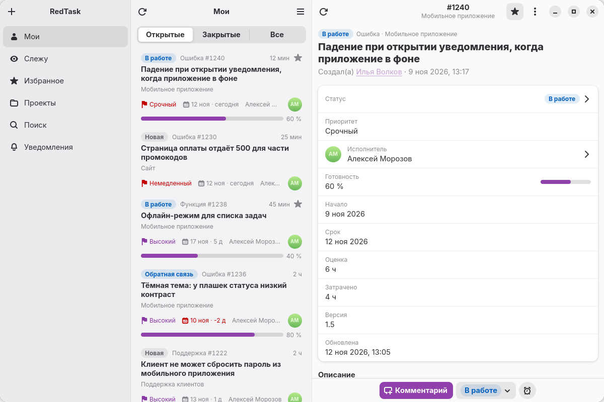
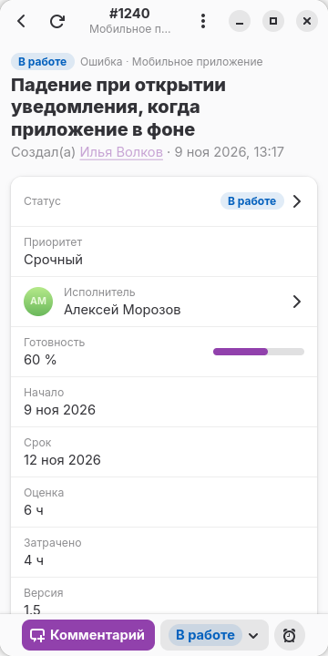
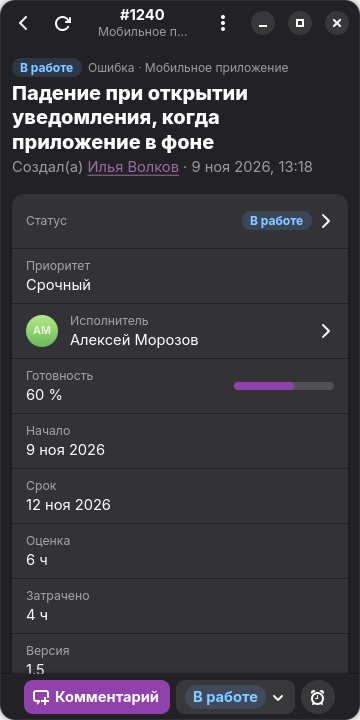

<p align="right"><b>English</b> · <a href="README.ru.md">Русский</a></p>

<p align="center">
  
</p>

<h1 align="center">RedTask</h1>

<p align="center">
  <em>A native Redmine client for GNOME — on the desktop and on the phone</em>
</p>

<p align="center">
  <a href="https://github.com/Toxblh/redtask-adw/releases"></a>
  
  
  <a href="LICENSE"></a>
</p>

<p align="center">
  <picture>
    <source media="(prefers-color-scheme: dark)" srcset="docs/screenshots/wide-dark.png">
    
  </picture>
</p>

## Features

- **My issues, watched, favorites, projects and search.** Open, closed and all issues in separate tabs
- **Issue details:** description, comments, change history and time entries
- **Edit fields:** status, assignee, done ratio, priority and every other field, custom fields included
- **Comments with Textile markup**, mentions and attachments with previews
- **Time tracking** right from the issue
- **Background notifications** about comments, mentions and changes
- **Links to your server** (issues, projects, people) open in the app when a link router such as Switchyard or [Junction](https://flathub.org/apps/re.sonny.Junction) is installed
- **Adaptive layout:** on a narrow screen the list and the issue fold into one column; the app works on screens from 360 pixels wide
- **API key in the keyring** (Secret Service), not in a plain file

<p align="center">
  
  &nbsp;&nbsp;
  
</p>

## Installation

### Flatpak with updates

```bash
flatpak install --user https://altlinux.space/toxblh/redmine-adw/raw/branch/flatpak/redtask.flatpakref
```

[Flathub](https://flathub.org/setup) must be set up: the GNOME 51 runtime comes from there. New versions arrive with `flatpak update`.

Ready-made `.flatpak` bundles are on the [releases](https://altlinux.space/toxblh/redmine-adw/releases) page.

### From source

```bash
git clone https://github.com/Toxblh/redtask-adw.git
cd redtask-adw
flatpak-builder --user --install --force-clean build-dir ru.toxblh.RedTask.json
flatpak run ru.toxblh.RedTask
```

Without flatpak you need Vala, meson and the libraries `gtk4 ≥ 4.16`, `libadwaita-1 ≥ 1.9`, `libsoup-3.0`, `json-glib-1.0`, `webkitgtk-6.0`, `libsecret-1`:

```bash
meson setup build
ninja -C build
meson test -C build
```

## First run

1. Enter your Redmine server address, for example `https://redmine.example.com`
2. Press **“Sign In on Website”** and sign in as usual. The app picks up the API key by itself
3. Or enter the key by hand: on the website it is under **My account → API access key → Show**

No server at hand? Press **“Try Demo”**: the app shows made-up issues and sends nothing over the network.

The server must have the REST API enabled: **Administration → Settings → API → Enable REST web service**.

## License

[GPL-3.0-or-later](LICENSE).

RedTask is an independent project; it is not affiliated with or endorsed by the Redmine project.
