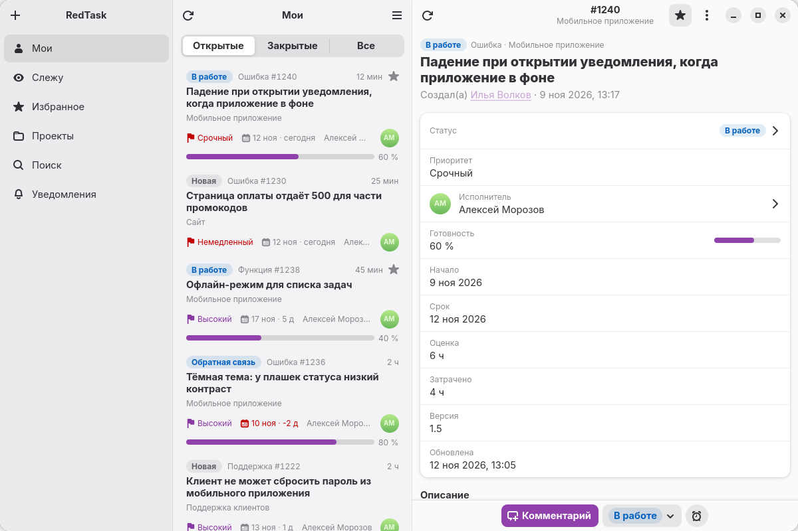
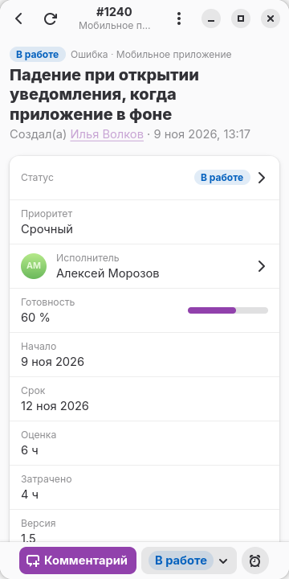
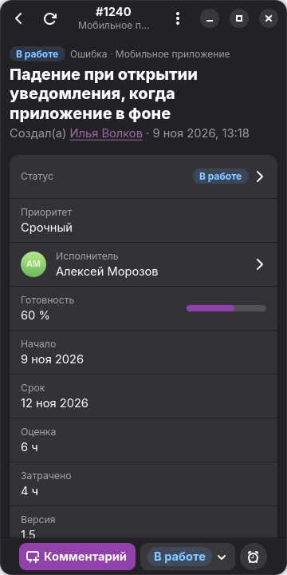

<p align="right"><a href="README.md">English</a> · <b>Русский</b></p>

<p align="center">
  
</p>

<h1 align="center">RedTask</h1>

<p align="center">
  <em>Нативный клиент Redmine для GNOME — на компьютере и на телефоне</em>
</p>

<p align="center">
  <a href="https://github.com/Toxblh/redtask-adw/releases"></a>
  
  
  <a href="LICENSE"></a>
</p>

<p align="center">
  <picture>
    <source media="(prefers-color-scheme: dark)" srcset="docs/screenshots/wide-dark.png">
    
  </picture>
</p>

## Возможности

- **Мои задачи, отслеживаемые, избранное, проекты и поиск.** Открытые, закрытые и все задачи разложены по вкладкам
- **Карточка задачи:** описание, комментарии, история изменений и трудозатраты
- **Правка полей:** статус, исполнитель, готовность, приоритет и все остальные поля, включая пользовательские
- **Комментарии с разметкой Textile**, упоминания и вложения с предпросмотром
- **Учёт времени** прямо из задачи
- **Уведомления в фоне** о комментариях, упоминаниях и изменениях
- **Ссылки на ваш сервер** (задачи, проекты, люди) открываются в приложении, если стоит маршрутизатор ссылок вроде Switchyard или [Junction](https://flathub.org/apps/re.sonny.Junction)
- **Адаптивный интерфейс:** на узком экране список и карточка складываются в одну колонку, приложение работает на экране от 360 пикселей
- **Ключ API в связке ключей** (Secret Service), а не в открытом файле

<p align="center">
  
  &nbsp;&nbsp;
  
</p>

## Установка

### Flatpak с обновлениями

```bash
flatpak install --user https://altlinux.space/toxblh/redmine-adw/raw/branch/flatpak/redtask.flatpakref
```

Нужен подключённый [Flathub](https://flathub.org/setup): оттуда ставится среда GNOME 51. Новые версии приходят через `flatpak update`.

Готовые бандлы `.flatpak` лежат в [релизах](https://altlinux.space/toxblh/redmine-adw/releases).

### Из исходников

```bash
git clone https://github.com/Toxblh/redtask-adw.git
cd redtask-adw
flatpak-builder --user --install --force-clean build-dir ru.toxblh.RedTask.json
flatpak run ru.toxblh.RedTask
```

Без flatpak нужны Vala, meson и библиотеки `gtk4 ≥ 4.16`, `libadwaita-1 ≥ 1.9`, `libsoup-3.0`, `json-glib-1.0`, `webkitgtk-6.0`, `libsecret-1`:

```bash
meson setup build
ninja -C build
meson test -C build
```

## Первый запуск

1. Укажите адрес сервера Redmine, например `https://redmine.example.com`
2. Нажмите **«Войти через сайт»** и войдите как обычно. Ключ API приложение заберёт само
3. Или введите ключ вручную: на сайте он находится в разделе **Моя учётная запись → Ключ доступа к API → Показать**

Нет под рукой сервера — нажмите **«Попробовать без сервера»**: приложение покажет выдуманные задачи, в сеть ничего не уходит.

На сервере должен быть включён REST API: **Администрирование → Настройки → API → Подключить веб-сервис REST**.

## Лицензия

[GPL-3.0-or-later](LICENSE).

RedTask — независимый проект, он не связан с проектом Redmine и не одобрен им.
